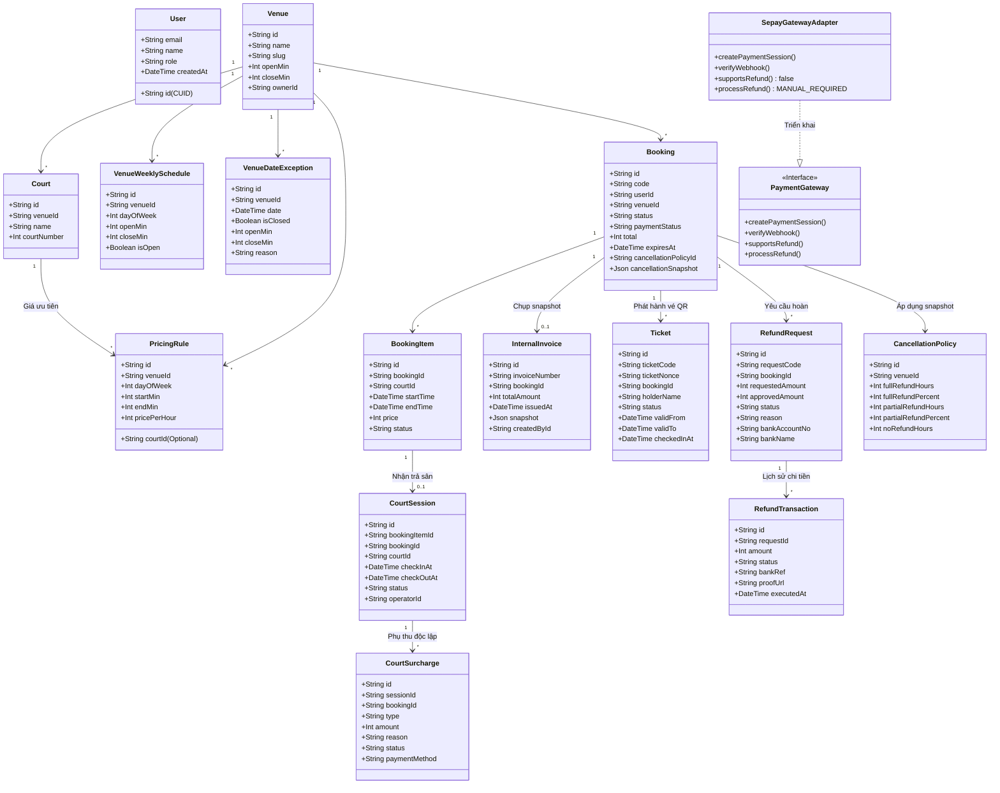

# BÁO CÁO BỔ SUNG CÁC NGHIỆP VỤ CÒN THIẾU CỦA SMASHBOOK

**Dự án:** SmashBook — Hệ thống Đặt Sân Cầu Lông Trực Tuyến  
**Thời gian hoàn thành:** 21/10/2026  
**Chi nhánh Git:** `codex/group-payment-trial`  
**Trạng thái kiểm thử:** 160/160 test suites đạt (100% PASS), TypeScript Strict Mode (0 lỗi), ESLint (0 cảnh báo), Production Build 24/24 static & dynamic routes đạt 100%.

---

## PHẦN 1 — ĐỐI CHIẾU THIẾT KẾ & 4 QUYẾT ĐỊNH NGHIỆP VỤ

### 1.1 Bảng đối chiếu Class Diagram và Mã nguồn thực tế

| Thành phần Diagram / Nghiệp vụ | Trạng thái trong Code cũ | Phân loại | Hướng xử lý và triển khai |
| :--- | :--- | :--- | :--- |
| **User & Vai trò** | Bảng `User`, trường `role: CUSTOMER \| OWNER \| STAFF \| ADMIN` | Khác biệt mô hình hóa | **Quyết định 1:** Giữ vai trò ngữ cảnh linh hoạt theo cơ sở (Owner/Staff qua bảng `PartnerMember` và quyền sở hữu `Venue.ownerId`). Không cần bảng động nhiều vai trò gây phức tạp. |
| **Giá theo sân / Khung giờ** | Bảng `PricingRule` (chỉ có `venueId`) | Thiếu trường `courtId` | **Quyết định 2:** Bổ sung `courtId` (nullable) vào `PricingRule`. Quy tắc giá có `courtId` cụ thể được ưu tiên cao hơn giá chung theo `venueId`. (Thực hiện theo BR03). |
| **Giữ chỗ (Reservation/Hold)** | `Booking.expiresAt` + `BookingItem.status = HELD` | Khác biệt mô hình hóa | Giữ nguyên kiến trúc hiện tại, chuẩn hóa `HOLD_TTL_SECONDS = 300` (5 phút) tại `constants.ts` và cơ chế giải phóng nguyên tử (BR02). |
| **Vé đơn & Check-in** | Chỉ có `GroupShare.ticketNonce` cho đơn nhóm | Thiếu chức năng | **Quyết định 4:** Bổ sung model `Ticket` đại diện cho người đặt (hoặc thành viên chia tiền), tạo chữ ký số HMAC `ST.<ticketId>.<hmac>`, quét 1 lần duy nhất chống re-entry (BR06). |
| **Chứng từ / Hóa đơn** | Chỉ có `Payment` và `SepayReceipt` | Thiếu chức năng | Bổ sung model `InternalInvoice` (Mục A): phát hành biên lai nội bộ idempotent, chụp snapshot bất biến ngày giờ, tiền và người đặt. |
| **Phiên sân & Phụ thu** | Chỉ có `BookingItem` | Thiếu chức năng | Bổ sung `CourtSession` và `CourtSurcharge` (Mục B): check-in nhận sân, trả sân, phụ thu quá giờ/nước uống tách biệt khỏi `Payment` gốc để bảo toàn đối soát. |
| **Lịch hoạt động & Ngoại lệ** | `Venue.openMin` & `closeMin` tĩnh | Thiếu chức năng | Bổ sung `VenueWeeklySchedule` & `VenueDateException` (Mục C): độ ưu tiên: Ngoại lệ ngày > Lịch tuần > Giờ mặc định cơ sở. |
| **Chính sách hủy & Hoàn tiền** | Hàm hủy tĩnh trong `coach.service.ts` | Thiếu chức năng | **Quyết định 3:** Bổ sung `CancellationPolicy` theo snapshot và `RefundRequest`, `RefundTransaction` (Mục D): cho phép hoàn nhiều lần (trần bằng thực thu), quy trình thủ công có chứng từ ngân hàng. |
| **Cổng thanh toán Adapter** | File xử lý trực tiếp SePay | Thiếu kiến trúc Adapter | Tạo interface `PaymentGateway` và `SepayGatewayAdapter` (Mục E): tuân thủ OCP, thông báo `supportsRefund() = false` yêu cầu hoàn thủ công có kiểm soát. |
| **Nhật ký kiểm toán** | Bảng `AdminAudit` | Đã có, cần mở rộng | Đóng gói service `logAdminAudit` ghi nhận mọi thay đổi lịch, phiên sân, phụ thu, hóa đơn, và hoàn tiền (Mục F). |

---

### 1.2 Class Diagram Cập Nhật (Mermaid)



---

## PHẦN 2 — CÁC NGHIỆP VỤ BỔ SUNG CHI TIẾT

### A. Hóa Đơn / Biên Lai Nội Bộ (`InternalInvoice`)
- **Tự động & Idempotent:** Khi thanh toán thành công hoặc khách hàng/nhân viên yêu cầu xuất hóa đơn, hệ thống kiểm tra nếu đã có `InternalInvoice` thì trả về bản ghi hiện tại, tránh phát hành trùng.
- **Số chứng từ quy chuẩn:** Định dạng `INV-YYYYMMDD-XXXXXX`.
- **Snapshot bất biến:** Lưu trữ toàn bộ thông tin đơn hàng, danh sách sân, HLV, ưu đãi và các khoản thanh toán tại thời điểm phát hành. Khi giá sân hay cấu hình cơ sở thay đổi trong tương lai, lịch sử chứng từ vẫn nguyên vẹn.
- **Quyền hạn Server-side:** Chỉ chủ đơn (`userId`), chủ sân/nhân viên cơ sở hoặc Admin mới có quyền xem và in chứng từ.
- **Tuyên bố pháp lý:** Ghi chú rõ trên giao diện và PDF: *"Biên lai nội bộ ghi nhận dịch vụ thể thao sân bãi, không thay thế hóa đơn điện tử GTGT theo quy định thuế"*.

### B. Phiên Sử Dụng Sân và Phụ Thu (`CourtSession` & `CourtSurcharge`)
- **Phân tách phiên và đơn:** Phiên sân gắn với từng `BookingItem` để theo dõi chính xác thời gian bắt đầu nhận sân thực tế (`checkInAt`), trả sân (`checkOutAt`), và người thao tác (`operatorId`).
- **Phụ thu phát sinh:** Cho phép nhân viên thêm phụ thu quá giờ (`OVERTIME`), nước uống (`BEVERAGE`), thuê vợt/cầu (`EQUIPMENT_RENTAL`), làm hỏng tài sản sân (`DAMAGES`), hoặc dịch vụ khác.
- **Bảo toàn giao dịch cũ:** Các khoản phụ thu được lưu trữ trong bảng riêng `CourtSurcharge`, không sửa đổi số tiền của `Payment` gốc đã thanh toán nhằm bảo toàn dữ liệu đối soát kế toán.
- **Idempotency:** Thao tác nhận sân hoặc trả sân lặp lại không tạo thêm phiên mới.

### C. Lịch Hoạt Động Cơ Sở (`VenueWeeklySchedule` & `VenueDateException`)
- **Quy tắc ưu tiên chặt chẽ:**
  $$\text{Ngoại lệ theo ngày (VenueDateException)} \succ \text{Lịch tuần theo thứ (VenueWeeklySchedule)} \succ \text{Giờ mặc định cơ sở (openMin/closeMin)}$$
- **Kiểm tra xung đột:** Khi quản lý cơ sở thay đổi giờ đóng cửa sớm hơn hoặc khai báo ngày nghỉ ngoại lệ, hệ thống kiểm tra các đơn đặt sân đã tồn tại. Nếu phát hiện đơn đã thanh toán hoặc đang giữ chỗ, hệ thống đưa ra cảnh báo chi tiết và ngăn chặn việc tự ý hủy đơn của khách hàng.
- **Đồng bộ hóa 2 chiều:** Lịch hoạt động được áp dụng tại cả `reservation.service.ts` (API backend kiểm tra khả dụng) và giao diện đặt sân frontend.

### D. Chính Sách Hủy & Quy Trình Hoàn Tiền Có Kiểm Soát
- **Snapshot chính sách:** Mỗi `Booking` khi tạo đều được đính kèm snapshot của `CancellationPolicy` tại thời điểm đó:
  - Hủy trước 24 giờ: Hoàn 100% tiền sân.
  - Hủy từ 4 đến 24 giờ: Hoàn 50% tiền sân.
  - Hủy dưới 4 giờ: Không hoàn tiền (0%).
- **Kiểm soát hoàn tiền (Refund Cap):**
  $$\sum \text{approvedAmount} \le \text{Tổng tiền thực thu từ các giao dịch PAID} - \sum \text{tiền đã hoàn}$$
- **Quy trình hoàn tiền thực tế cho SePay:**
  Do cổng thanh toán ngân hàng trực tiếp không hỗ trợ webhook hoàn tiền tự động, hệ thống triển khai luồng hoàn thủ công 3 bước:
  1. Khách hàng gửi yêu cầu (`RefundRequest` ở trạng thái `REQUESTED`), nhập thông tin tài khoản ngân hàng nhận tiền.
  2. Nhân viên/Chủ sân duyệt yêu cầu (`APPROVED`), xác định số tiền được hoàn theo chính sách.
  3. Nhân viên chuyển khoản ngân hàng và nhập mã giao dịch ngân hàng (`bankRef`) kèm ảnh biên lai để chuyển trạng thái sang `COMPLETED`, sinh bản ghi `RefundTransaction`.

### E. Cổng Thanh Toán Adapter & Vé QR Check-in
- **PaymentGateway Adapter:**
  Định nghĩa giao diện chuẩn `PaymentGateway` với các phương thức: `createPaymentSession`, `verifyWebhook`, `supportsRefund`, `processRefund`. Class `SepayGatewayAdapter` hiện thực hóa interface này, khai báo minh bạch `supportsRefund() = false` để kích hoạt luồng hoàn thủ công.
- **Vé QR Điện Tử Độc Lập:**
  - Áp dụng cho cả đơn cá nhân lẫn đơn nhóm.
  - Chữ ký bảo mật HMAC: `ST.<ticketId>.<hmac(sha256)>`.
  - Giới hạn hiệu lực: Mở trước 30 phút giờ chơi và đóng sau 30 phút kết thúc.
  - Chống quét trùng/Race condition: Sử dụng `updateMany({ where: { status: 'UNUSED' } })` để đảm bảo 2 yêu cầu quét đồng thời chỉ 1 yêu cầu thành công.

### F. Nhật Ký Kiểm Toán Toàn Diện (`AdminAudit`)
- Mọi thao tác quan trọng đều được ghi nhật ký:
  - Cập nhật lịch hoạt động và ngoại lệ ngày nghỉ.
  - Check-in nhận sân, trả sân và cập nhật phiên sân.
  - Thêm mới và thanh toán các khoản phụ thu.
  - Phát hành hóa đơn/chứng từ nội bộ.
  - Phê duyệt và hoàn tất chuyển khoản hoàn tiền.
- Không lưu thông tin nhạy cảm (như mật khẩu, secret hay private token).

---

## PHẦN 3 — KIỂM THỬ RÀNG BUỘC NGHIỆP VỤ (BR01 - BR06)

Bộ kiểm thử [tests/extended-business-suite.test.cjs](file:///e:/Project%20Demo/Badminton%20Court%20Booking%20Website/tests/extended-business-suite.test.cjs) kết hợp cùng toàn bộ test suite cũ đã kiểm chứng trọn vẹn:

1. **BR01 (Concurrency & Idempotency):**
   - Giữ chỗ và đặt sân đồng thời được khóa an toàn qua Prisma Transaction.
   - Thao tác quét vé đồng thời và tạo chứng từ đồng thời không sinh dữ liệu trùng.
2. **BR02 (Thời gian giữ chỗ 5 phút):**
   - Hằng số `HOLD_TTL_SECONDS = 300` (5 phút) được áp dụng đồng nhất.
   - Các hàm tính `expiresAt` thiết lập đúng $300\text{ giây}$.
3. **BR03 (Quy tắc giá sân):**
   - Khi có `PricingRule` gắn với `courtId`, hệ thống ưu tiên áp dụng mức giá riêng của sân đó trước mức giá chung của `venueId`.
4. **BR04 (Quy tắc hoàn tiền theo snapshot và mốc giờ):**
   - Đảm bảo tính toán hoàn trả 100%, 50% hoặc 0% dựa trên thời gian hủy so với giờ bắt đầu.
   - Ràng buộc trần hoàn tiền ngăn chặn hoàn vượt số tiền thực nhận.
5. **BR05 (Bảo toàn tổng chia tiền nhóm):**
   - Hàm `splitAmounts` bảo toàn tuyệt đối: tổng các phần chia luôn luôn bằng tổng tiền đơn hàng sau khi trừ phí HLV đã hủy hoặc áp dụng mã ưu đãi.
6. **BR06 (Vé điện tử QR & Check-in):**
   - Xác thực chữ ký số HMAC của vé, kiểm tra khoảng thời gian hiệu lực và chống quét lặp thành công 100%.

---

## PHẦN 4 — DANH SÁCH FILE THAY ĐỔI VÀ TẠO MỚI

### Schema & Database Migration
- [`prisma/schema.prisma`](file:///e:/Project%20Demo/Badminton%20Court%20Booking%20Website/prisma/schema.prisma): Bổ sung 9 models và cập nhật quan hệ (`VenueWeeklySchedule`, `VenueDateException`, `CancellationPolicy`, `InternalInvoice`, `CourtSession`, `CourtSurcharge`, `RefundRequest`, `RefundTransaction`, `Ticket`).
- [`prisma/patches/20261021_extended_business_models.sql`](file:///e:/Project%20Demo/Badminton%20Court%20Booking%20Website/prisma/patches/20261021_extended_business_models.sql): Bản vá SQL DDL an toàn với `CREATE TABLE IF NOT EXISTS`, `ALTER TABLE ... ADD COLUMN IF NOT EXISTS`, và các indexes.

### Services Nghiệp Vụ
- [`src/lib/config/constants.ts`](file:///e:/Project%20Demo/Badminton%20Court%20Booking%20Website/src/lib/config/constants.ts): Chuẩn hóa `HOLD_TTL_SECONDS = 300`.
- [`src/lib/booking.ts`](file:///e:/Project%20Demo/Badminton%20Court%20Booking%20Website/src/lib/booking.ts) & [`src/lib/booking-request.ts`](file:///e:/Project%20Demo/Badminton%20Court%20Booking%20Website/src/lib/booking-request.ts): Ưu tiên giá theo `courtId`.
- [`src/services/payment-gateway/gateway.interface.ts`](file:///e:/Project%20Demo/Badminton%20Court%20Booking%20Website/src/services/payment-gateway/gateway.interface.ts): Định nghĩa kiến trúc cổng thanh toán.
- [`src/services/payment-gateway/sepay.adapter.ts`](file:///e:/Project%20Demo/Badminton%20Court%20Booking%20Website/src/services/payment-gateway/sepay.adapter.ts): Hiện thực adapter cho SePay.
- [`src/services/invoice.service.ts`](file:///e:/Project%20Demo/Badminton%20Court%20Booking%20Website/src/services/invoice.service.ts): Quản lý phát hành biên lai nội bộ.
- [`src/services/session.service.ts`](file:///e:/Project%20Demo/Badminton%20Court%20Booking%20Website/src/services/session.service.ts): Quản lý phiên sân và phụ thu.
- [`src/services/schedule.service.ts`](file:///e:/Project%20Demo/Badminton%20Court%20Booking%20Website/src/services/schedule.service.ts): Quản lý lịch tuần và ngoại lệ ngày nghỉ.
- [`src/services/policy.service.ts`](file:///e:/Project%20Demo/Badminton%20Court%20Booking%20Website/src/services/policy.service.ts): Quản lý chính sách hủy và snapshot.
- [`src/services/refund.service.ts`](file:///e:/Project%20Demo/Badminton%20Court%20Booking%20Website/src/services/refund.service.ts): Quản lý luồng hoàn tiền có kiểm soát.
- [`src/services/ticket.service.ts`](file:///e:/Project%20Demo/Badminton%20Court%20Booking%20Website/src/services/ticket.service.ts): Phát hành vé QR và xác thực check-in.
- [`src/services/audit-log.service.ts`](file:///e:/Project%20Demo/Badminton%20Court%20Booking%20Website/src/services/audit-log.service.ts): Ghi nhật ký kiểm toán vào `AdminAudit`.
- [`src/services/reservation.service.ts`](file:///e:/Project%20Demo/Badminton%20Court%20Booking%20Website/src/services/reservation.service.ts): Tích hợp kiểm tra lịch hoạt động và gắn chính sách hủy.

### API Routes
- [`src/app/api/bookings/[code]/invoice/route.ts`](file:///e:/Project%20Demo/Badminton%20Court%20Booking%20Website/src/app/api/bookings/[code]/invoice/route.ts): Xem và phát hành biên lai nội bộ.
- [`src/app/api/bookings/[code]/ticket/route.ts`](file:///e:/Project%20Demo/Badminton%20Court%20Booking%20Website/src/app/api/bookings/[code]/ticket/route.ts): Lấy thông tin vé QR và chữ ký.
- [`src/app/api/tickets/check-in/route.ts`](file:///e:/Project%20Demo/Badminton%20Court%20Booking%20Website/src/app/api/tickets/check-in/route.ts): Quét vé check-in tại sân.
- [`src/app/api/venue-operations/sessions/route.ts`](file:///e:/Project%20Demo/Badminton%20Court%20Booking%20Website/src/app/api/venue-operations/sessions/route.ts): Nhận sân, trả sân, thêm phụ thu, thanh toán phụ thu.
- [`src/app/api/bookings/[code]/refund-request/route.ts`](file:///e:/Project%20Demo/Badminton%20Court%20Booking%20Website/src/app/api/bookings/[code]/refund-request/route.ts): Khách gửi yêu cầu hoàn tiền.
- [`src/app/api/venue-operations/refunds/route.ts`](file:///e:/Project%20Demo/Badminton%20Court%20Booking%20Website/src/app/api/venue-operations/refunds/route.ts): Chủ sân duyệt yêu cầu và xác nhận chuyển khoản hoàn tất.
- [`src/app/api/venues/[slug]/schedule/route.ts`](file:///e:/Project%20Demo/Badminton%20Court%20Booking%20Website/src/app/api/venues/[slug]/schedule/route.ts): Cập nhật lịch hoạt động và ngoại lệ ngày nghỉ.

### Giao Diện Người Dùng (UI)
- [`src/app/bookings/page.tsx`](file:///e:/Project%20Demo/Badminton%20Court%20Booking%20Website/src/app/bookings/page.tsx): Modal xem/in biên lai nội bộ, xem vé QR, form gửi yêu cầu hoàn tiền.
- [`src/app/venue-operations/page.tsx`](file:///e:/Project%20Demo/Badminton%20Court%20Booking%20Website/src/app/venue-operations/page.tsx): Tab Quét vé QR Check-in, tab Phiên sân & Phụ thu, tab Phê duyệt và chuyển khoản hoàn tiền thủ công.

### Kiểm Thử Tự Động
- [`tests/extended-business-suite.test.cjs`](file:///e:/Project%20Demo/Badminton%20Court%20Booking%20Website/tests/extended-business-suite.test.cjs): Suite kiểm thử toàn diện các module mở rộng và ràng buộc BR02 - BR06.

---

## PHẦN 5 — HƯỚNG DẪN THỰC THI & CÁC BƯỚC TIẾP THEO

### 5.1 Lưu ý về Cơ Sở Dữ Liệu Thực (Supabase PostgreSQL)
- **TUYỆT ĐỐI KHÔNG CHẠY** `prisma db push`, `prisma migrate reset`, hoặc tạo dữ liệu giả trực tiếp trên database thật qua terminal.
- File SQL an toàn đã được chuẩn bị tại [`prisma/patches/20261021_extended_business_models.sql`](file:///e:/Project%20Demo/Badminton%20Court%20Booking%20Website/prisma/patches/20261021_extended_business_models.sql).

### 5.2 Lệnh Thực Thi Tại Terminal PowerShell

Chạy kiểm tra lại toàn bộ test suite:
```powershell
npm test
```

Kiểm tra cú pháp schema Prisma:
```powershell
npx prisma validate
```

Kiểm tra kiểu dữ liệu TypeScript Strict:
```powershell
npx tsc --noEmit
```

Kiểm tra quy chuẩn mã nguồn ESLint:
```powershell
npm run lint
```

Chạy build kiểm tra môi trường Production:
```powershell
npm run build
```

Khởi chạy môi trường phát triển cục bộ:
```powershell
npm run dev
```

### 5.3 Thao Tác Trên Supabase (Khi triển khai Migration)
1. Đăng nhập vào Supabase Dashboard của dự án SmashBook.
2. Điều hướng đến mục **SQL Editor**.
3. Mở file [`prisma/patches/20261021_extended_business_models.sql`](file:///e:/Project%20Demo/Badminton%20Court%20Booking%20Website/prisma/patches/20261021_extended_business_models.sql) trong dự án.
4. Sao chép toàn bộ nội dung SQL và chạy (Run) trên Supabase. Toàn bộ câu lệnh đều sử dụng `CREATE TABLE IF NOT EXISTS` và `ADD COLUMN IF NOT EXISTS`, tuyệt đối không gây mất mát dữ liệu cũ.

### 5.4 Thao Tác Trên Vercel (Khi Deploy)
1. Kiểm tra các biến môi trường cấu hình tại Vercel Settings > Environment Variables:
   - `DATABASE_URL` (Direct connection string)
   - `DIRECT_URL` (Supabase Direct URL)
   - `AUTH_SECRET` (Khóa bí mật tạo chữ ký vé QR và session)
   - `SEPAY_WEBHOOK_SECRET`, `BANK_BIN`, `BANK_ACCOUNT_NO`, `BANK_ACCOUNT_NAME`, `SEPAY_BANK_GATEWAY`
2. Kích hoạt Deploy mới từ nhánh git đã được kiểm thử và phê duyệt.
