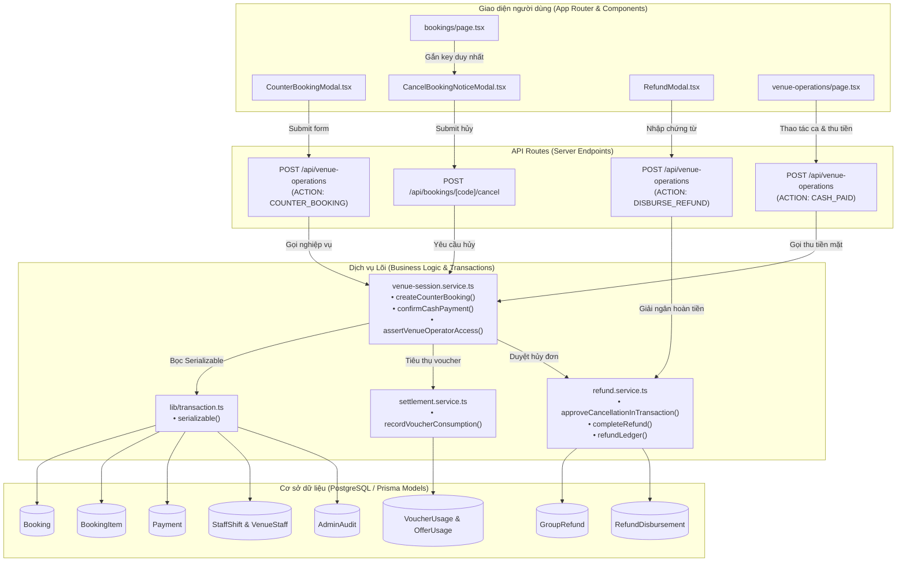

# Tài liệu Luồng Nghiệp vụ & Cấu trúc Dữ liệu SmashBook

**Ngày cập nhật**: 30/10/2026  
**Revision cơ sở**: `146a8f26fb8ee1a687e8f6454ca799be9d49a2b5` + Các cải tiến nghiệp vụ ngày 30/10/2026.  
**Mục tiêu**: Chuẩn hóa luồng nghiệp vụ đặt sân, vận hành theo ca, thanh toán tiền mặt/voucher, hủy lịch và ghi sổ hoàn tiền.

---

## 1. Sơ đồ Kiến trúc Tổng thể (Mermaid Diagram)

---

## 2. Chi tiết 5 Luồng Nghiệp vụ Trọng tâm

### Luồng 1: Đặt sân tại quầy & Chống trùng lặp (Idempotency)
- **Xác thực quyền**: 
  - `ADMIN` và chủ sở hữu thực tế của cơ sở (`ownerId === actor.id`) được miễn ca trực.
  - Mọi membership nhân viên cơ sở (`VenueStaff.isActive = true`) bắt buộc phải có ca trực đang mở (`StaffShift.endedAt = null`). Người dùng có role toàn hệ thống là `OWNER` của sân khác khi thao tác tại cơ sở này với tư cách nhân viên vẫn bắt buộc phải vào ca trực.
- **Ràng buộc Idempotency**:
  - `requestId` được kiểm tra toàn cục: Trước khi trả về booking cũ, hệ thống bắt buộc kiểm tra quyền của operator trên chính `existing.venueId`.
  - Từ chối ngay (409) nếu `existing.venueId !== input.venueId` hoặc `existing.source !== "COUNTER"`.
  - So khớp payload chuẩn hóa: sân (`courtId`), ngày (`date`), giờ (`startMin`, `endMin`), thông tin khách (`customerName`, `customerPhone`), và phương thức thanh toán (`paymentMethod`). Nếu thay đổi bất kỳ trường nào khi giữ cùng `requestId`, hệ thống từ chối `409 Conflict`.
- **Tính giá đa khung giờ**:
  - Kiểm tra ngày lịch thực hợp lệ (chống ngày ảo 30/02) và khung giờ không nằm trong quá khứ. Cho phép đặt bắt đầu ngay tại phút hiện tại của thời gian thực tế tại quầy.
  - Duyệt từng phút phủ kín khoảng `[startMin, endMin]`, áp dụng đúng quy tắc giá theo ngày trong tuần (`daysOfWeek`). Nếu thiếu giá hoặc cấu hình chồng lấn giá khác nhau, hệ thống trả lỗi rõ ràng, không tự ý fallback về giá sàn.

### Luồng 2: Thu tiền mặt tại quầy & Tiêu thụ Voucher/PartnerOffer
- **Xác thực**: Bắt buộc nhân viên có ca trực đang mở. Đơn nhóm bị từ chối thu tổng tại đây (phải thu theo suất tại màn hình nhóm).
- **Ghi nhận thanh toán**:
  - Tạo bản ghi `Payment` với `provider = "CASH"`, `status = "PAID"`.
  - Cập nhật `Booking.paymentStatus = "PAID"`, `Booking.hasCashPayment = true`, `Booking.manualHandoverRequired = true`.
- **Tiêu thụ Voucher đồng thời**:
  - Gọi `recordVoucherConsumption(tx, booking.id, booking.voucherId, booking.userId, ...)` trong cùng transaction Serializable với `Payment` và `Booking`.
  - Chuyển `OfferUsage` từ `RESERVED` sang `CONSUMED`, tăng `usedBudget` và `currentUsage` của đối tác.
  - Ghi nhận `VoucherUsage` và tăng `Voucher.usedCount`.
  - Đảm bảo tính lũy thừa (idempotent), không nhân đôi khi gọi lại hoặc retry.

### Luồng 3: Hộp thoại Hủy đơn & Phân biệt Trạng thái (UI/UX)
- **Độc lập trạng thái**:
  - `CancelBookingNoticeModal` được gán `key={cancelModalData?.code}` tại trang cha, đảm bảo remount sạch sẽ khi mở các đơn khác nhau.
  - Bên trong modal, cơ chế `activeRequestIdRef` loại bỏ race condition khi response của request cũ trả về sau khi người dùng đã chuyển đơn hoặc đóng modal.
  - Giữ nguyên nội dung lý do đang nhập nếu trang cha thực hiện re-render ngầm (background refresh).
  - Hỗ trợ phím `Escape` đóng hộp thoại an toàn khi không ở trạng thái bận (`busy = false`).
- **Phân biệt kết quả**:
  - Đơn chưa thanh toán (`UNPAID`): Hủy ngay lập tức, giải phóng sân, phản hồi rõ *"Đơn đặt sân đã được hủy thành công."*
  - Đơn đã thanh toán (`PAID`): Chuyển sang chờ duyệt, phản hồi rõ *"Yêu cầu hủy đơn đã được gửi tới chủ cơ sở. Đang chờ phê duyệt và xử lý hoàn tiền."* (không gây hiểu nhầm là đã nhận được tiền ngay).

### Luồng 4: Sổ Hoàn tiền (Refund Ledger) & Giải ngân có Chứng từ
- **Nguyên tắc bảo toàn**:
  - `Payment` giữ nguyên chứng từ thu gốc; không tạo `REFUND-COACH-*` làm khoản thu mới.
  - `GroupRefund` dùng chung cho cá nhân và nhóm; theo dõi `amount` (nghĩa vụ hoàn đã duyệt) và `completedAmount` (tiền thực tế đã chi).
  - Tiền còn được duyệt hoàn = `thực thu − đã duyệt`. Tiền còn phải chi = `đã duyệt − đã chi`.
  - Bảng `RefundDisbursement` lưu từng lần chi: số tiền nguyên VND, mã chứng từ riêng biệt (chuẩn hóa `UPPER(TRIM())`, `UNIQUE` toàn hệ thống), người ghi nhận và thời điểm.
  - Bật Row Level Security (RLS) trên bảng `RefundDisbursement`, thu hồi quyền trực tiếp từ `PUBLIC`, `anon` và `authenticated`.

### Luồng 5: HLV Hủy ca & Tái cân bằng Đơn nhóm
- **Hủy ca dạy**: Khấu trừ chính xác học phí HLV khỏi tổng booking. Tiền thực thu vượt tổng mới được chuyển thành nghĩa vụ hoàn gắn theo tỷ trọng từng `Payment` thực trả, dùng số học số nguyên `BigInt` bảo toàn từng đồng VND lẻ.
- **Quyền dùng sân**: Giữ nguyên quyền nhận sân cho khách nếu tiền thực thu đã đủ phần tiền sân (`BookingItem.status = "CONFIRMED"`).
- **Hủy sân sau hủy HLV**: Cộng dồn nghĩa vụ hoàn trên số tiền sân còn giữ (`available`), giữ nguyên lịch sử và số tiền đã chi trước đó.
