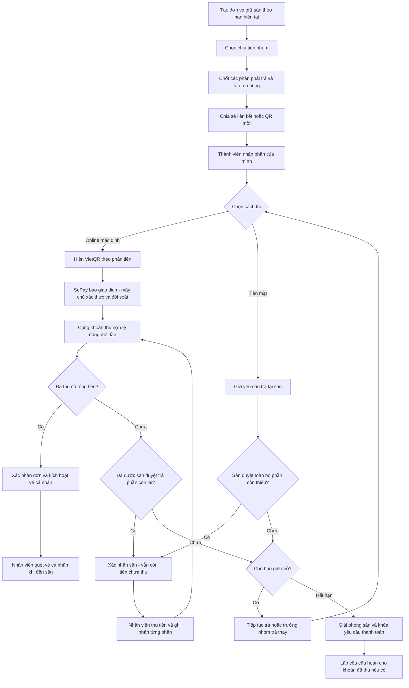

# Phân tích luồng chia tiền nhóm và QR

Ngày đối chiếu: 10/10/2026. Trạng thái: thiết kế đã được triển khai trên nhánh thử codex/group-payment-trial. Xem group-payment-implementation.vi.md để biết cách dùng, kiểm thử và giới hạn triển khai.

## 1. Cơ sở và phạm vi

Đối chiếu `Sportbooking.docx`, ActivityDiagram1.2, MainActivityDiagram, DFD1.3–1.5, các sơ đồ Sequence, UseCase/BFD do người dùng cung cấp với mã nguồn và `docs/payment-choice.md` hiện tại. Tài liệu được dùng làm yêu cầu tham khảo; yêu cầu mới của người dùng về QR mặc định và tiền mặt do sân kiểm duyệt được ưu tiên khi có khác biệt.

Luồng thống nhất đề xuất: **một đơn sân → chia nghĩa vụ thanh toán cho thành viên → QR thanh toán riêng hoặc yêu cầu tiền mặt → tổng hợp tiền thực nhận → vé QR nhận sân cá nhân**. Mọi khoản thanh toán tiền sân chuyển vào tài khoản nhận tiền đã cấu hình cho hệ thống; không tự chuyển sang tài khoản cá nhân của trưởng nhóm.

Phạm vi này là nhiều người thanh toán trực tiếp cho cùng một đơn sân. Trường hợp trưởng nhóm đã trả toàn bộ rồi thu lại tiền bạn bè là luồng hoàn trả nội bộ khác; không phát thêm QR thu tiền về sân cho đơn đã thanh toán đủ.

## 2. Những điều phải giữ từ luồng trước

| Nội dung | Hiện tại | Áp dụng cho nhóm |
| --- | --- | --- |
| Tạo đơn | Tạo trước khi thanh toán, mặc định chuyển khoản | Giữ nguyên một đơn chính; nhóm không tạo nhiều đơn tranh cùng khung giờ |
| Hiển thị | QR và thông tin nhận tiền, nút tiền mặt bên cạnh | Mỗi thành viên thấy QR đúng phần của mình và nút “Thanh toán bằng tiền mặt” |
| Chọn tiền mặt | Chưa xác nhận đặt sân, chưa ghi nhận đã trả | Chỉ tạo yêu cầu cho phần tiền tương ứng |
| Duyệt tiền mặt | Nhân viên/chủ sân xác nhận giữ sân, tiền vẫn chưa thu | Phải duyệt toàn bộ phần còn thiếu mà nhóm cam kết trả tại sân để xác nhận cả đơn |
| Thu tiền mặt | Thao tác riêng, có người xác nhận và nhật ký | Ghi nhận từng phần thực thu; không dùng thao tác thu toàn bộ tổng đơn |
| Chuyển khoản | Máy chủ xác thực thông báo SePay rồi ghi nhận | Giữ xác thực và chống trùng; đối chiếu mã và số tiền của từng yêu cầu thanh toán |
| Check-in | Đơn xác nhận và đã trả đủ | Cả đơn đủ tiền rồi mới kích hoạt vé cá nhân |
| Giữ chỗ | Tối đa 10 phút, không vượt giờ bắt đầu sân | Dùng chung hạn của đơn; tham gia nhóm/đổi phương thức không gia hạn |

Tài liệu và sơ đồ đang ghi 5 phút (BR02), khác mã nguồn hiện tại là tối đa 10 phút. Đề xuất giữ chính sách hiện tại trong phiên bản này và sửa tài liệu cho thống nhất; nếu đổi về 5 phút thì phải đổi đồng thời hệ thống và tài liệu. Không tạo đồng hồ giữ chỗ riêng cho từng người.

## 3. Phân biệt ba loại QR

| Loại QR | Chứa gì | Quét để làm gì | Có xác nhận đã trả tiền không? |
| --- | --- | --- | --- |
| QR mời nhóm | Liên kết tham gia với mã mời khó đoán | Mở trang nhóm, đăng nhập và tham gia | Không |
| QR thanh toán | Ngân hàng, tài khoản nhận, số tiền, mã tham chiếu riêng | Mở ứng dụng ngân hàng và chuyển tiền | Không; phải chờ SePay xác nhận hợp lệ |
| Vé QR nhận sân | Mã vé cá nhân khó đoán | Nhân viên kiểm tra quyền vào sân | Chỉ phản ánh điều kiện đã được máy chủ kiểm tra |

Chia sẻ một QR của tổng đơn cho cả nhóm không phải chia tiền tự động. Hai người cùng trả một số tiền vẫn cần hai mã tham chiếu khác nhau để biết phần nào đã được thanh toán.

## 4. Luồng người dùng đề xuất

1. **Tạo đơn sân.** Trang kết quả tiếp tục hiện QR tổng đơn và nút tiền mặt như hiện tại, thêm “Chia tiền với nhóm”. Chỉ mở chế độ chia tiền khi đơn còn hiệu lực và chưa có khoản thu nào được ghi nhận.
2. **Tạo nhóm.** Trưởng nhóm chọn số người, chia đều mặc định (bao gồm trưởng nhóm), hoặc nhập số tiền từng người. Các vị trí chưa có người tham gia được giữ trong danh sách; người tham gia không tự làm tăng số người hay giảm phần của người khác.
3. **Chốt bảng chia.** Máy chủ kiểm tra tổng các phần đúng bằng tiền đơn. Sau khi chốt và phát mã thanh toán, khóa số tiền và danh sách phần phải trả trong phiên bản đầu. Người tham gia nhận một vị trí còn trống, không tính lại tiền. Muốn đổi bảng chia cần quy trình sửa riêng; không âm thầm thay QR đã chia sẻ.
4. **Chia sẻ lời mời.** Trưởng nhóm dùng nút sao chép liên kết hoặc QR mời. Thành viên đăng nhập, tham gia một lần và nhận phần được giao. Không gửi tin nhắn bên ngoài thay người dùng.
5. **Thanh toán phần cá nhân.** Màn hình hiển thị tiền phần mình, ngân hàng/tên chủ tài khoản/số tài khoản, nội dung chuyển khoản riêng, QR mặc định, và nút tiền mặt bên cạnh. Có tổng tiền nhóm đã thu và số tiền còn thiếu.
6. **Cập nhật tiến độ.** Chỉ thông báo ngân hàng đã xác thực hoặc thao tác xác nhận đã thu của nhân viên mới tăng tiền thực nhận. Nút “Tôi đã chuyển khoản”, nếu có, chỉ tải lại trạng thái.
7. **Xử lý phần còn thiếu.** Trưởng nhóm có thể trả thay các phần chưa trả bằng một QR bù tiền, hoặc xin trả phần còn lại tại sân. Không tự trừ tiền trưởng nhóm. Phải hoàn thành trước hạn giữ chỗ, trừ khi sân đã duyệt cho trả sau.
8. **Xác nhận đơn và nhận sân.** Đủ tiền thì xác nhận đơn và kích hoạt vé QR cá nhân. Nếu sân đã duyệt trả tiền mặt nhưng chưa thu đủ, hiển thị “Đã xác nhận sân — còn … cần thanh toán”; vé chưa được dùng để check-in.

Khi vào chế độ nhóm, ẩn QR tổng đơn và ngừng tự đối soát mã tổng đơn để tránh thu cả tổng tiền lẫn từng phần. QR cũ đã chụp vẫn có thể được dùng trong ứng dụng ngân hàng: nếu có tiền về, ghi nhận để đối soát, không tự bỏ qua hoặc tính thêm lần nữa. Thao tác chuyển sang nhóm và nhận thanh toán phải được kiểm tra nguyên tử để xử lý trường hợp xảy ra cùng lúc.

Hạn 10 phút bao gồm cả thời gian mời người và trả tiền. Giao diện phải nói rõ thời gian còn lại. Có thể bổ sung bước lập nhóm trước khi đặt sân ở phiên bản sau; bước đó không được tuyên bố đã giữ sân.

## 5. Trạng thái đơn và tiền phải tách riêng

| Tình huống | Trạng thái sân/đơn | Trạng thái tiền | Vé nhận sân |
| --- | --- | --- | --- |
| Vừa tạo, chưa thu | Đang giữ chỗ | Chờ thanh toán | Chưa hoạt động |
| Một số người đã trả | Đang giữ chỗ | Đã thu một phần | Chưa hoạt động |
| Chọn tiền mặt, sân chưa duyệt | Đang giữ chỗ | Chờ thu hoặc đã thu một phần | Chưa hoạt động |
| Sân duyệt toàn bộ dư nợ trả tại sân | Đã xác nhận | Chưa đủ tiền | Chưa hoạt động |
| Tổng tiền thực nhận đủ | Đã xác nhận | Đã thanh toán | Hoạt động theo khung giờ |
| Hết hạn, chưa đủ và chưa được sân duyệt trả sau | Hết hạn, giải phóng sân | Nếu đã thu: cần xử lý hoàn | Vô hiệu |
| Hủy đơn đã thu tiền | Đã hủy, giải phóng sân | Xử lý hoàn theo chính sách áp dụng | Vô hiệu |

Điều kiện xác nhận đơn: `đã thu đủ` HOẶC `toàn bộ số còn thiếu đã được sân chấp thuận trả tại sân`. Duyệt tiền mặt cho riêng một người không xác nhận cả đơn nếu vẫn còn các phần thiếu chưa được duyệt.

Điều kiện đã thanh toán: tổng tiền hợp lệ phân bổ vào các phần của đơn bằng tổng tiền đơn. Cam kết tiền mặt, ảnh biên lai, lời xác nhận của thành viên và tiền chưa đối soát không được cộng vào tổng này.

Ví dụ đơn 150.000đ, bốn người mỗi người 37.500đ: hai người chuyển khoản thì đã thu 75.000đ. Nếu sân duyệt 75.000đ còn lại trả tại sân, đơn được xác nhận nhưng vẫn còn nợ 75.000đ. Trưởng nhóm trả thay 37.500đ thì còn nợ 37.500đ. Nhân viên thu và xác nhận phần cuối mới chuyển đơn sang đã thanh toán, kích hoạt vé cho bốn người.

## 6. Luồng tổng quát

Thông báo SePay không khớp đi vào hàng chờ đối soát, không đi thẳng đến bước cộng tiền. Quy trình hết hạn phải chạy được ngay cả khi không ai mở trang nhóm; không phụ thuộc đồng hồ trên trình duyệt.

## 7. Đối soát, trả thay và tiền mặt

- Mỗi yêu cầu chuyển khoản có mã duy nhất, số tiền cố định, hạn hiệu lực và thông tin tài khoản nhận lưu tại thời điểm tạo. Mã cá nhân dùng không gian mã riêng, không ghép hậu tố vào mã `DATSAN...` rồi để bộ đọc cũ hiểu nhầm là thanh toán cả đơn.
- Giữ kiểm tra chữ ký, tài khoản, chiều tiền vào và mã giao dịch SePay duy nhất. Chỉ cộng khoản khớp đúng một yêu cầu còn hiệu lực. Số tiền bằng nhau không đủ để xác định người trả.
- Phiên bản đầu yêu cầu trả đúng số tiền trên QR. Thiếu, thừa, sai mã, nhiều mã, mã đã đóng hoặc tiền đến sau hạn đều ghi vào đối soát; không tự xác nhận. Nhân viên phải có hành động xử lý và nhật ký cho từng trường hợp.
- Trưởng nhóm trả thay: máy chủ khóa các phần chưa trả được chọn, vô hiệu yêu cầu thanh toán cũ, tạo một yêu cầu mới bằng đúng tổng phần đó. Khi thực nhận, phân bổ giao dịch vào từng phần và lưu người trả thay. Không đổi người sở hữu vé.
- Nếu thành viên chuyển tiền đồng thời với trưởng nhóm, kiểm tra lại các phần trong cùng giao dịch cơ sở dữ liệu. Khoản đến sau cho phần đã được trả phải vào đối soát/hoàn tiền, không ghi nhận hai lần. Thay QR trên web không ngăn được người dùng chuyển tiền bằng QR cũ.
- Nhân viên duyệt trả tại sân và nhân viên xác nhận đã thu là hai thao tác riêng. Khi thu phải chọn các phần cụ thể, hiển thị đúng dư nợ mới nhất; xác nhận không được làm số đã thu vượt tổng đơn.
- Tiền online vẫn có thể về sau khi đã chọn/duyệt tiền mặt. Nếu phần còn thiếu và yêu cầu còn hợp lệ, ghi nhận online rồi giảm số cần thu tại sân. Nếu tiền mặt đã thu trước, khoản online vào đối soát.
- Mọi giao dịch ghi nhận, phân bổ, trạng thái phần và trạng thái đơn phải cập nhật nguyên tử. Gửi lại thông báo ngân hàng hoặc bấm thu tiền hai lần không tạo thêm khoản thu.

## 8. Hết hạn, hủy và hoàn tiền

Hết hạn giữ chỗ mà chưa đủ tiền và chưa được duyệt trả sau: giải phóng sân, đóng các yêu cầu thanh toán, khóa vé; tạo nghĩa vụ hoàn cho các khoản đã nhận. Đề xuất hoàn toàn bộ khoản đã thu khi nhóm không thể chốt đơn do hết hạn. Đây là quy tắc cần bổ sung vào BR05, tách khỏi tỷ lệ BR04 dành cho khách chủ động hủy đơn đã xác nhận.

Hủy đơn đã xác nhận: áp dụng chính sách hủy được lưu cho đơn; tính tiền hoàn trên các khoản thực thu, không hoàn phần chỉ mới hứa trả tiền mặt. Mỗi khoản hoàn phải truy được về giao dịch gốc và người thực trả. Trưởng nhóm trả thay thì phần hoàn tương ứng thuộc người trả thay, không tự trả cho người sở hữu vé. Làm tròn phần hoàn phải bảo toàn tổng số tiền được hoàn.

Mã nguồn hiện tại chỉ có trạng thái chờ hoàn và xử lý đối soát, chưa đủ cơ sở để cam kết tự động chuyển tiền hoàn qua ngân hàng. Vì vậy sơ đồ cần dùng “Tạo yêu cầu hoàn → xử lý → xác nhận kết quả”, không coi tạo yêu cầu là hoàn thành. Không tự hoàn vào tài khoản do một thành viên khác nhập. Tiền đến muộn được ghi nhận và xử lý riêng, không khôi phục đơn đã giải phóng sân.

## 9. Vé cá nhân và quyền truy cập

Mỗi thành viên đã tham gia có một vé riêng, chỉ hoạt động khi đơn đã xác nhận và trả đủ. Nhân viên quét vé phải kiểm tra đúng sân mình quản lý, trạng thái đơn, khung giờ, hiệu lực vé và việc vé đã dùng hay chưa trên máy chủ. Vé đầu tiên ghi nhận giờ nhận sân; các vé còn lại vẫn được quét khi đơn đã ở trạng thái đang chơi. Không cập nhật lại giờ bắt đầu cho mỗi thành viên.

Trưởng nhóm quản lý danh sách và tiến độ; thành viên xem phần của mình và tiến độ tổng hợp, không xem dữ liệu ngân hàng cá nhân hay biên lai riêng của người khác. Liên kết mời không cấp quyền sửa đơn hoặc đánh dấu đã trả tiền. Chủ sân/nhân viên chỉ duyệt và thu trong các sân được phân quyền. Mọi quyền phải kiểm tra tại máy chủ.

## 10. Những phần cần bổ sung trong mã nguồn

Hiện chưa có mô hình nhóm, phần tiền thành viên hoặc vé cá nhân. `src/services/sepay.service.ts` yêu cầu tiền chuyển bằng `booking.total`; `src/lib/sepay.ts` chỉ tạo/đọc mã `DATSAN...`; thao tác `CASH_PAID` trong `src/services/admin.service.ts` ghi nhận tổng tiền đơn. Chỉ đổi giao diện QR sẽ không đủ.

Mô hình đề xuất ở mức thiết kế:

| Thành phần | Vai trò và ràng buộc |
| --- | --- |
| Nhóm đặt sân | Liên kết duy nhất với đơn; trưởng nhóm, trạng thái, phiên bản bảng chia, mã mời |
| Thành viên/phần tiền | Một vị trí trong nhóm, người nhận, số tiền nguyên VND, trạng thái yêu cầu và phê duyệt tiền mặt; tổng phần bằng tổng đơn |
| Yêu cầu thanh toán | Mã tham chiếu duy nhất, số tiền, hạn, tài khoản nhận, người trả dự kiến; có thể bao phủ nhiều phần khi trả thay |
| Phân bổ khoản thu | Liên kết giao dịch thực thu với một hoặc nhiều phần; không phân bổ vượt nghĩa vụ hoặc vượt tiền giao dịch |
| Giao dịch/SePayReceipt | Giữ sổ giao dịch thực nhận, chống trùng và đối soát; không thay bằng cờ do khách gửi |
| Yêu cầu hoàn | Gắn khoản thu gốc, số cần hoàn, người thực trả, trạng thái xử lý và bằng chứng hoàn |
| Vé cá nhân | Gắn thành viên và đơn, mã khó đoán lưu dạng băm, lần sử dụng và người kiểm tra |

Cần bổ sung trạng thái thanh toán tổng “Đã thu một phần” và cập nhật toàn bộ chỗ kiểm tra trạng thái, không chỉ thêm nhãn giao diện. Phương thức thực thu nằm ở từng giao dịch; đơn hỗn hợp hiển thị “Chuyển khoản + tiền mặt”, không ép cả đơn thành `CASH` hoặc `BANK_TRANSFER`. Không dùng `MIXED` như một nhà cung cấp giao dịch ngân hàng.

Chia đều dùng số nguyên VND: lấy phần nguyên của tổng/số người, phân phối phần dư 1đ theo thứ tự ổn định. Ví dụ 100.000đ/3 = 33.334đ + 33.333đ + 33.333đ. Giới hạn số người để mọi phần phải trả dương trong phiên bản đầu. Đơn cũ không có nhóm tiếp tục dùng mã và cách đối soát cũ.

Thứ tự triển khai: (1) dữ liệu và quy tắc chia/đối soát nguyên tử; (2) nhận tiền từng phần và trả thay, giữ tương thích đơn cũ; (3) duyệt/thu tiền mặt từng phần và hết hạn/hoàn; (4) giao diện nhóm, lời mời, QR; (5) vé cá nhân và check-in. Chỉ mở tính năng khi các nhánh tiền mặt, hết hạn và khoản thu trùng đã hoàn chỉnh.

## 11. Điều chỉnh bộ sơ đồ và tài liệu

| Tài liệu/sơ đồ | Điều chỉnh cần thiết |
| --- | --- |
| MainActivityDiagram | Chuyển nhánh chia tiền lên trước bước thanh toán; bỏ cách hiểu đã trả toàn bộ rồi tiếp tục thu tiền nhóm |
| ActivityDiagram1.2 | Thêm lane Chủ sân/Nhân viên, QR thanh toán từng phần, duyệt tiền mặt và ghi nhận thực thu; vé hoạt động khi cả đơn đủ tiền |
| Activity luồng chính, DFD1.2, Sequence1 | Thống nhất hạn giữ chỗ với hệ thống; thêm nhánh tiền mặt; tạo đơn trước thanh toán |
| DFD1.3 | Kết quả ngân hàng đã xác thực hoặc chứng từ thu tiền từ nhân viên mới cập nhật khoản thu; thêm trạng thái đã thu một phần |
| DFD1.4 | Thành viên gửi yêu cầu thanh toán tới tiến trình 3.0; tiến trình 4.0 nhận kết quả đối soát từ 3.0 trước khi phát vé, không nhận lời xác nhận của khách làm bằng chứng |
| DFD mức 0/ngữ cảnh | Bổ sung dữ liệu yêu cầu/duyệt/thu tiền mặt giữa khách, nhân viên và hệ thống; dữ liệu tổng hợp tiền giữa 3.0 và 4.0 |
| DFD1.5 và Sequence3 | Phân biệt vé từng người với trạng thái nhận sân cả đơn; quét vé còn lại không bị chặn vì người đầu đã check-in |
| Activity hủy và Sequence2 | Tách yêu cầu hoàn với kết quả hoàn thực tế; hoàn theo người thực trả và khoản thu gốc |
| UseCase/BFD | Bổ sung trả tiền mặt, duyệt trả tại sân, xác nhận đã thu, trưởng nhóm trả thay; online là một lựa chọn, không phải bước bắt buộc của mọi đơn |
| Sportbooking.docx | Thống nhất lại mã UC với sơ đồ; bổ sung trạng thái một phần, ba loại QR và quy tắc nhóm hết hạn |

Nên bổ sung một Sequence Diagram riêng cho nhóm gồm: Trưởng nhóm, Thành viên, Web, Máy chủ, Cơ sở dữ liệu, SePay và Nhân viên sân; thể hiện giao dịch lặp, trả thay đồng thời và hai bước tiền mặt. Kho D2 giữ đơn/giữ chỗ; D3 giữ tiền thực thu/hoàn; D4 giữ nhóm, phân chia và vé. Không nhân đôi doanh thu ở D3 và D4.

## 12. Tiêu chí kiểm chứng khi triển khai

1. Tổng các phần luôn đúng tổng đơn, kể cả chia lẻ; chốt bảng chia xong thì người mới vào không đổi số tiền trên QR đã phát.
2. Hai thành viên trả bằng nhau được ghi nhận đúng phần nhờ mã riêng; cùng giao dịch SePay gửi nhiều lần chỉ được tính một lần.
3. Chọn tiền mặt không làm đơn đã trả; duyệt giữ sân không làm tiền đã thu; thu từng phần không tạo giao dịch tổng đơn lần nữa.
4. Online, tiền mặt và trưởng nhóm trả thay cùng đóng góp vào một tổng tiền; tranh chấp đồng thời không thu/ghi nhận trùng.
5. Hết hạn không phụ thuộc trang web đang mở; người đã chuyển tiền có hồ sơ hoàn/đối soát, người chưa chuyển không có khoản hoàn giả.
6. Mã QR cũ, khoản sai số tiền và khoản đến muộn không xác nhận nhầm đơn; mọi khoản tiền thật đều có hướng xử lý.
7. Chưa đủ tiền thì vé chưa dùng được; sau khi đủ tiền, từng vé được dùng một lần và các thành viên đến sau vẫn check-in được.
8. Thành viên không tự sửa số tiền/đánh dấu đã trả; nhân viên sân khác không xem hoặc thu tiền cho đơn ngoài phạm vi.
9. Đơn đã thanh toán toàn bộ không phát sinh lần thu thứ hai khi mở chức năng nhóm; đơn không có nhóm vẫn chạy như trước.

Tài liệu này là phân tích và thiết kế để triển khai tiếp, không phải xác nhận các chức năng nhóm đã hoạt động trên Vercel/Supabase.
