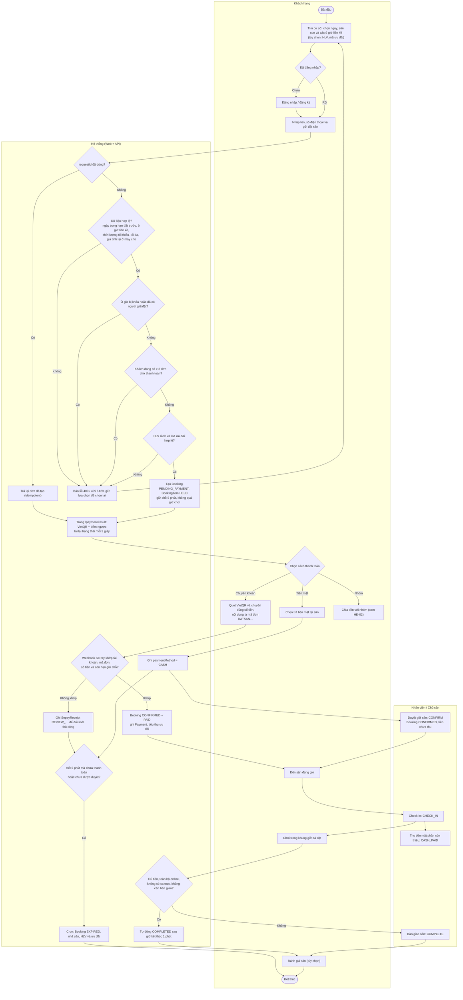
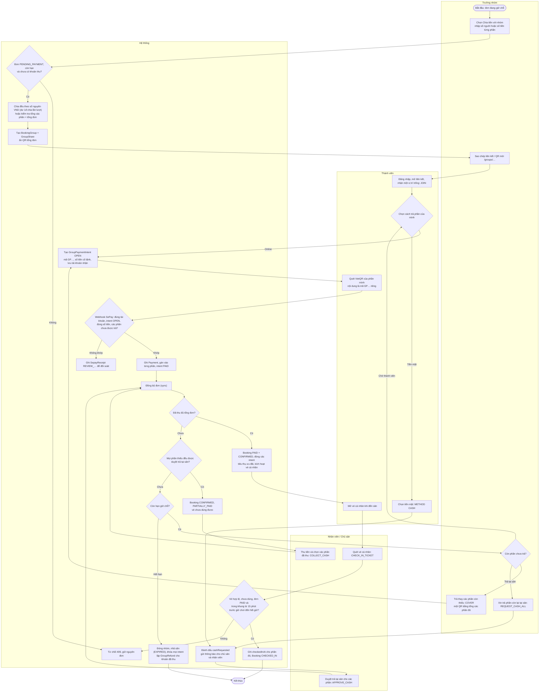
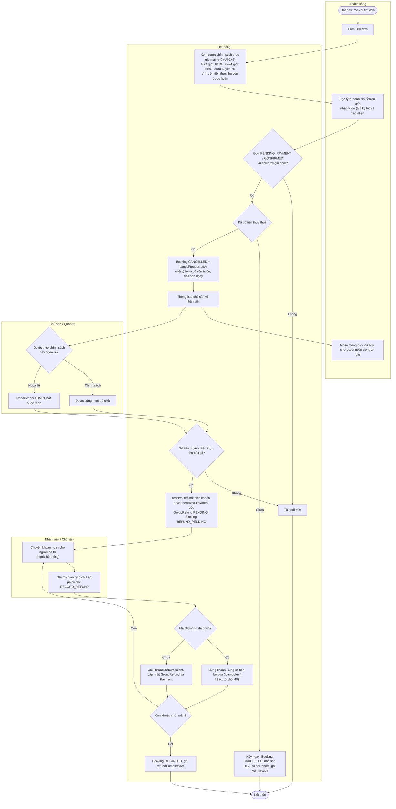
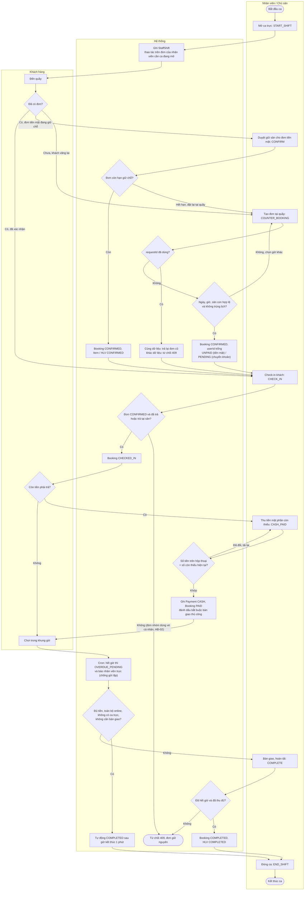
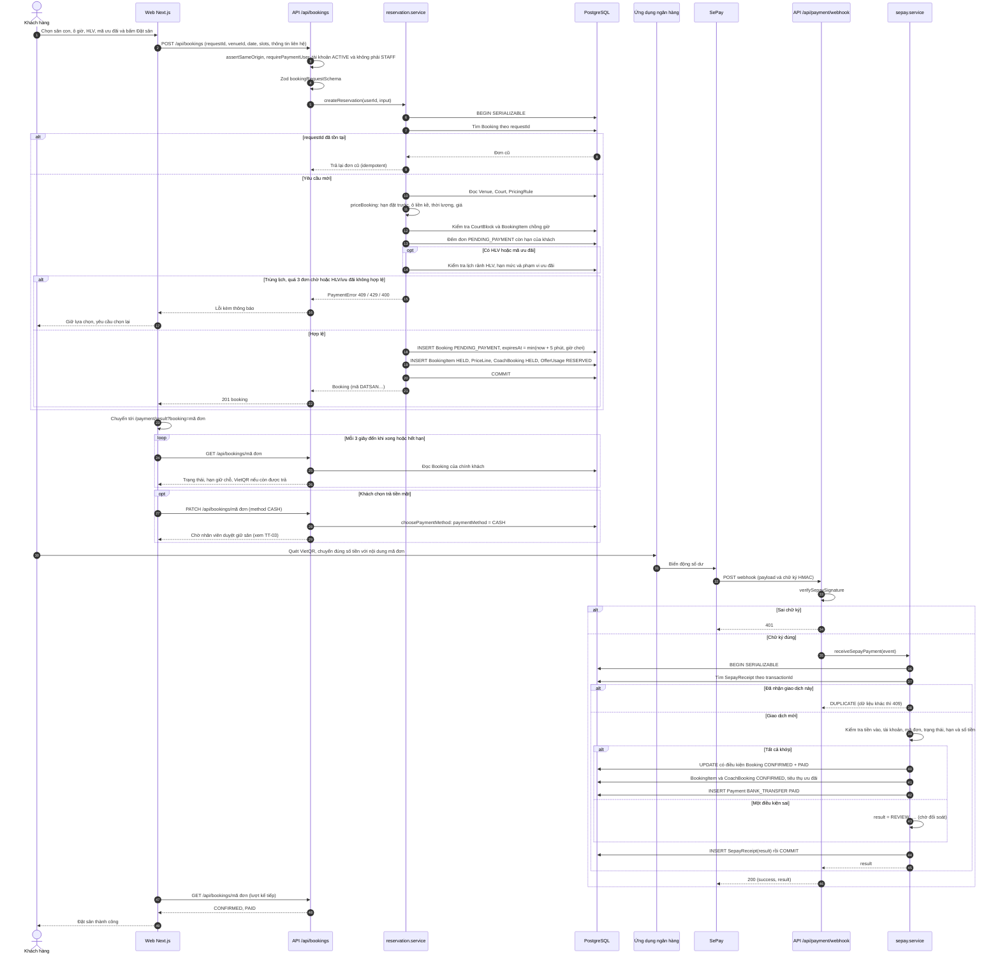
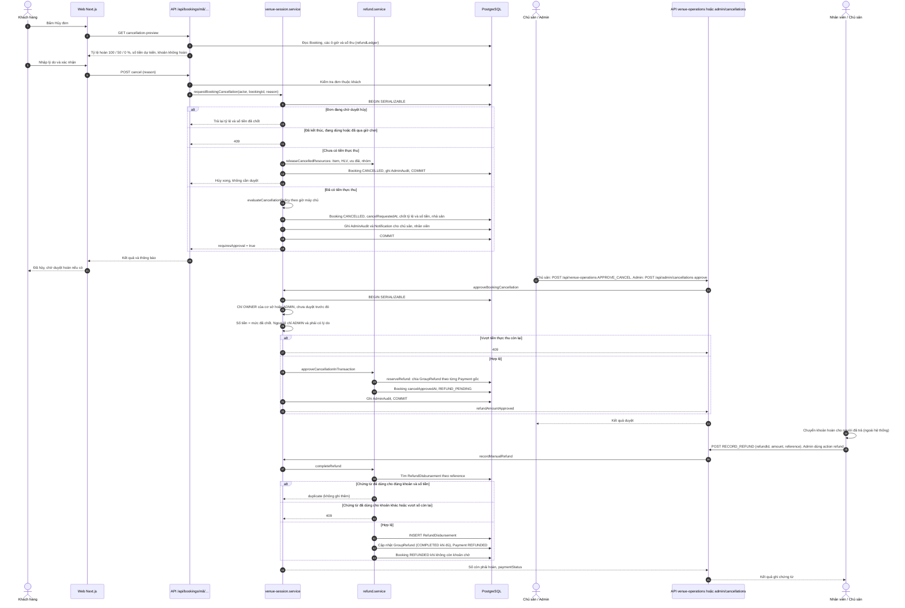
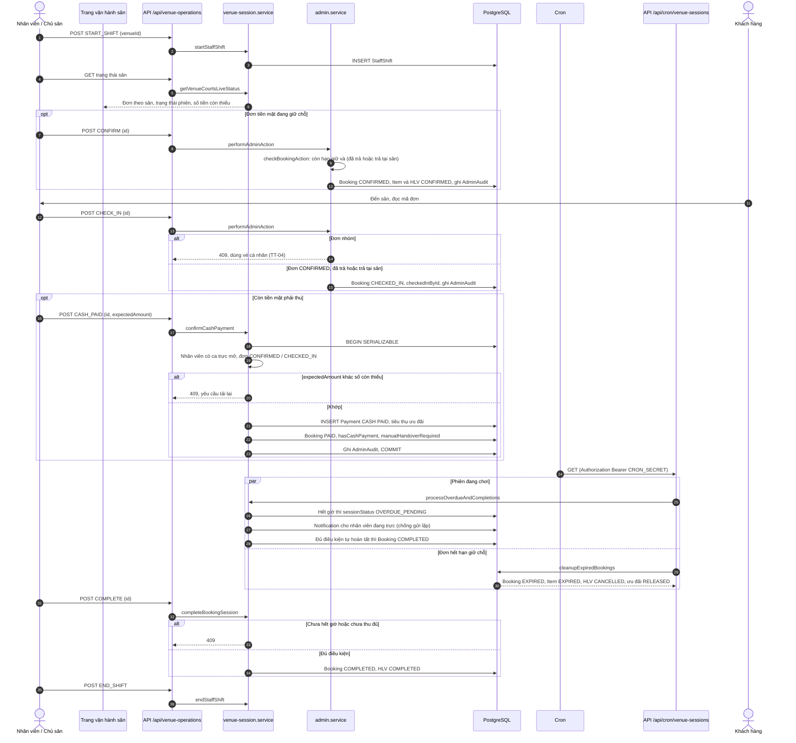
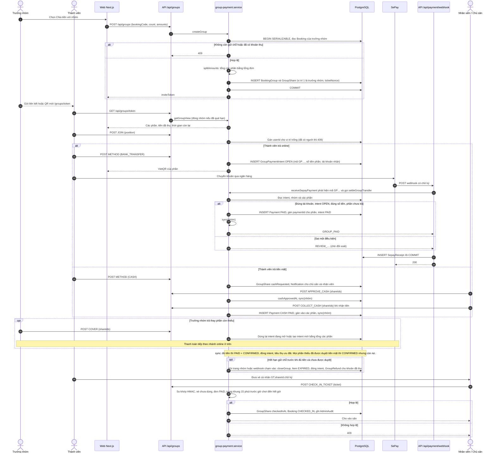

# Bộ sơ đồ Hoạt động (Activity) và Tuần tự (Sequence) — SmashBook

Vẽ lại ngày 2026-11-26 theo mã nguồn tại commit `0cb5839` và đồ thị Graphify chạy lại cùng ngày (`graphify-out/GRAPH_REPORT.md`: 2280 node, 5357 cạnh, 143 cộng đồng). Bộ này thay cho các sơ đồ cũ ở `badminton-booking-spec.md` §5.5–5.6 (VNPAY, Redis, giữ chỗ 10 phút) và `docs/group-payment-flow.vi.md` §6 (bản đề xuất trước khi triển khai).

Khác biệt chính so với bản cũ, đều lấy từ mã:

- Thanh toán online là chuyển khoản VietQR, xác nhận qua webhook SePay (`/api/payment/webhook`). Không còn VNPAY/IPN.
- Giữ chỗ là `HOLD_TTL_SECONDS = 300` (5 phút), không vượt quá giờ bắt đầu chơi. Chống trùng lịch bằng transaction `serializable` trên PostgreSQL, không dùng khóa Redis.
- Có ba cách trả: chuyển khoản cả đơn, tiền mặt tại sân (nhân viên duyệt giữ sân rồi thu tiền), hoặc chia tiền nhóm (mỗi phần một mã `GP…`).
- Hủy đơn đã thu tiền phải qua bước chủ sân/Admin duyệt. Tiền hoàn được ghi theo từng khoản thu gốc và chỉ đóng khi có chứng từ chi.

| Mã | Tên trong bộ tài liệu | Nội dung | Mã nguồn chính |
| --- | --- | --- | --- |
| HĐ-01 | MainActivityDiagram / Activity luồng chính | Đặt sân online từ chọn giờ đến hoàn tất | `reservation.service.ts`, `sepay.service.ts`, `payment/result/page.tsx` |
| HĐ-02 | ActivityDiagram1.2 | Chia tiền nhóm, QR từng phần, tiền mặt, vé cá nhân | `group-payment.service.ts`, `lib/group-payment.ts` |
| HĐ-03 | Activity hủy | Hủy đơn, duyệt hoàn, ghi chứng từ chi | `venue-session.service.ts`, `refund.service.ts`, `cancellation-policy.ts` |
| HĐ-04 | Activity vận hành sân | Ca trực, đặt tại quầy, check-in, thu tiền mặt, hoàn tất | `venue-operations/route.ts`, `venue-session.service.ts`, `admin.service.ts` |
| TT-01 | Sequence1 | Tạo đơn và thanh toán chuyển khoản SePay | `api/bookings`, `api/payment/webhook` |
| TT-02 | Sequence2 | Hủy và hoàn tiền | `api/bookings/[code]/cancel`, `api/venue-operations`, `api/admin/cancellations` |
| TT-03 | Sequence3 | Vận hành tại sân và tác vụ cron | `api/venue-operations`, `api/cron/venue-sessions` |
| TT-04 | Sequence nhóm | Thanh toán nhóm từ lập nhóm đến quét vé | `api/groups`, `api/groups/[token]`, `api/payment/webhook` |

Quy ước: sơ đồ hoạt động dùng `flowchart` của Mermaid, mỗi `subgraph` là một làn (swimlane). Hình thoi là điểm rẽ nhánh. Mã lỗi HTTP ghi kèm khi máy chủ từ chối.

---

## HĐ-01. Luồng chính đặt sân online (MainActivityDiagram)

Ghi chú:

- Chuyển khoản sai số tiền, sai nội dung, đến sau khi hết hạn hoặc trùng giao dịch đều không xác nhận đơn. Giao dịch được lưu ở `SepayReceipt` với kết quả `REVIEW_…` (`DUPLICATE` nếu SePay gửi lại).
- Đơn tiền mặt chỉ được check-in khi đã `CONFIRMED`. Muốn `COMPLETE` thì phải thu đủ tiền (`CASH_PAID`).
- Đơn đã `CONFIRMED` nhưng chưa trả vẫn có thể chuyển khoản online trước giờ chơi đầu tiên (`canPayBooking`).

---

## HĐ-02. Thanh toán chia tiền nhóm (ActivityDiagram1.2)

Ghi chú:

- Mỗi yêu cầu chuyển khoản dùng mã `GP` + 24 ký tự hex riêng, nên hai người trả cùng số tiền vẫn được ghi đúng phần. Nội dung chứa cả `GP…` lẫn `DATSAN…` sẽ bị đưa vào đối soát, không tự xác nhận.
- Trưởng nhóm bấm trả thay nhiều lần với cùng các phần thì dùng lại intent đang mở. Hệ thống không đổi QR mà người khác có thể đang quét.
- Hạn giữ chỗ được kiểm tra ở máy chủ, không theo đồng hồ trình duyệt. Nếu trang nhóm được mở hoặc webhook đến sau hạn, `expire()` đóng nhóm và lập `GroupRefund` cho khoản đã thu. Cron `cleanupExpiredBookings` chỉ chuyển đơn sang `EXPIRED` và nhả sân, chưa đóng nhóm hay lập khoản hoàn. Nếu cron chạy trước, khoản đã thu của nhóm phải đối soát thủ công.
- Hủy đơn nhóm (`closeGroup`) dùng ngưỡng riêng: trên 24 giờ hoàn 100%, 12–24 giờ 50%, dưới 12 giờ 0%. Đơn còn đang giữ chỗ được hoàn 100%. Ngưỡng này khác chính sách đơn lẻ ở HĐ-03 (mốc 6 giờ).

---

## HĐ-03. Hủy đơn và hoàn tiền (Activity hủy)

Ghi chú:

- Nhân viên có thể gửi yêu cầu hủy thay khách (`CANCEL_REQUEST`) và đi tiếp nhánh chờ duyệt như trên. Chủ sân hoặc Admin tự hủy thì được duyệt luôn trong cùng transaction.
- Khách gửi lại yêu cầu khi đơn đang chờ duyệt thì hệ thống trả lại tỷ lệ và số tiền đã chốt, không tính lại.
- Duyệt hoàn 0đ (hủy dưới 6 giờ) không tạo khoản hoàn. Trạng thái tiền giữ nguyên.

---

## HĐ-04. Vận hành tại sân (Activity vận hành sân)

Ghi chú:

- Nhân viên phải có ca trực đang mở mới được thao tác trên đơn. Chủ sân và Admin không cần ca trực.
- Đơn tại quầy được tạo thẳng ở `CONFIRMED`, không có hạn giữ chỗ. Gửi lại cùng `requestId` mà khác dữ liệu sẽ bị từ chối để không ghi đè đơn khác.
- Cron tự hoàn tất đơn khi đủ bốn điều kiện: đã thanh toán đủ, không có tiền mặt, không có nhân viên đang trực, không bị đánh dấu bàn giao thủ công. Các trường hợp còn lại do nhân viên bàn giao.

---

## TT-01. Tạo đơn và thanh toán chuyển khoản SePay (Sequence1)

---

## TT-02. Hủy đơn và hoàn tiền (Sequence2)

---

## TT-03. Vận hành tại sân và tác vụ định kỳ (Sequence3)

---

## TT-04. Thanh toán nhóm (Sequence nhóm)

---

## Chưa vẽ trong bộ này

Các luồng phụ có trong mã nhưng chưa có sơ đồ riêng: đổi lịch (`reschedule.service.ts`), chuyển nhượng đơn (`transfer.service.ts`), báo sự cố (`incident.service.ts`), đánh giá kèm ảnh (`review.service.ts`), HLV hủy ca (`api/coach/bookings/[id]/cancel`), đăng ký và xác thực email, đăng ký cơ sở và đối tác. Khi cần vẽ thêm, dùng `graphify explain "<tên hàm>"` để lấy các cạnh gọi hàm làm khung.
